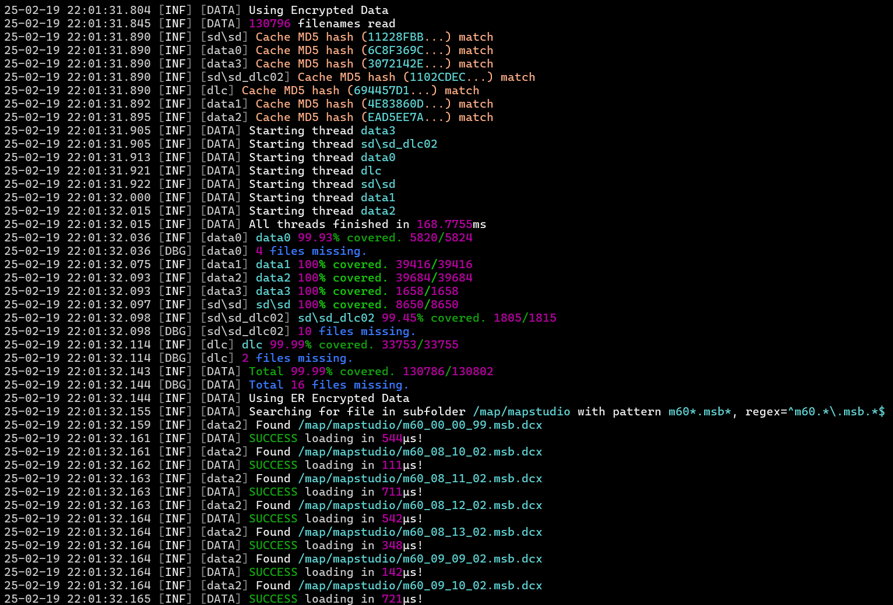

# DantelionDataManager
A .NET library for reading and writing **FromSoftware** game files, aimed at tool developers. One API over three kinds of game data:

| Type | Class | Source | Notes |
|---|---|---|---|
| Encrypted (packed) | `EncryptedData` | PC install | Dark Souls 3, Sekiro, Elden Ring, Armored Core VI |
| PKG | `PKGData` | PS4/PS5 `.pkg` | default pkg password only; patches supported |
| Decrypted (unpacked) | `DecryptedData` | unpacked folder | any game |

Encrypted and PKG sources are read-only. Writes always go to a separate output folder (`outPath`).

<sub>PKG/decrypted tested with Bloodborne, Elden Ring (incl. CNT), Dark Souls 3 CNT, Sekiro and Armored Core VI.</sub>

## Quick start
Every type takes a `rootPath` (where to read from) and an `outPath` (where to write to).

```cs
// packed PC data: rootPath is the folder with the game .exe
var er  = GameData.InitGameData_PostEldenRing(@"C:\...\ELDEN RING\Game", @"D:\out", BHD5.Game.EldenRing);
var ds3 = GameData.InitGameData_PreEldenRing(@"C:\...\Dark Souls III", @"D:\out", BHD5.Game.DarkSouls3);

// unpacked data: rootPath contains chr, map, etc.
var sekiro = GameData.InitGameData_Decrypted(@"D:\UnpackedSekiro", @"D:\out");

// PKG: rootPath is the .pkg itself
var bb = GameData.InitGameData_PKG(@"D:\Bloodborne.pkg", @"D:\out");
```

## Reading
`Get` returns a `GameFile` with `Path`, `Bytes` and `Data` (an `ISoulsFile`, filled when you pass a parser).

```cs
// one file
var chr = er.Get("/chr/c2120.chrbnd.dcx");
var bnd = BND4.Read(chr.Bytes);

// one file, parsed into .Data
var param = bb.Get("/param/gameparam/gameparam.parambnd.dcx", BND4.Read);

// many files by pattern (Windows Explorer-style wildcards)
foreach (var msb in er.Get("/map/mapstudio", "m60*.msb*", MSBE.Read))
{
    var m = (MSBE)msb.Data;
}
```

- A missing file returns **empty bytes, not null**.
- Pattern queries only return files that exist. Pass `load: false` to list files without loading their bytes.

## Writing
```cs
er.Set("/chr/c2120.chrbnd.dcx", bnd.Write()); // -> D:\out\chr\c2120.chrbnd.dcx

// or, if .Data is set:
msb.Write(er);
```

## How it works
- **BHD cache** — on first run, BHDs are decrypted with the keys in the working `Data` folder and cached as `.bhdcache` (MD5-checked). Later runs load the cache for fast startup; invalid caches are rebuilt. BDT files are decrypted on demand.
- **Unsupported games** — keys are read from the game exe and dumped. Without a file dictionary, pattern lookups won't work; files you request by exact path are recorded and dumped to `Data` on shutdown.
- **PKG patches** — files present in a patch are read from it instead of the base pkg.

## Dependencies
- [SoulsFormats](https://github.com/kotn3l/SoulsFormats/tree/newest) — fork keeping MemoryMappedFile support, synced with [SoulsFormatsNEXT](https://github.com/soulsmods/SoulsFormatsNEXT), plus a BHD5 header dictionary for fast hash lookups.
- [LibOrbisPkg](https://github.com/kotn3l/LibOrbisPkg) — ported to modern .NET.
- BouncyCastle.Cryptography, CommunityToolkit.HighPerformance, DotNext.IO, DotNext.Unsafe, ZstdNet

## Logging
Uses Serilog, writing to the console by default.



## Credits
Thanks to the modding community, especially:
* TGKP
* Nordgaren
* Smithbox contributors
* SoulsFormatsNEXT contributors
* Meowmaritus
